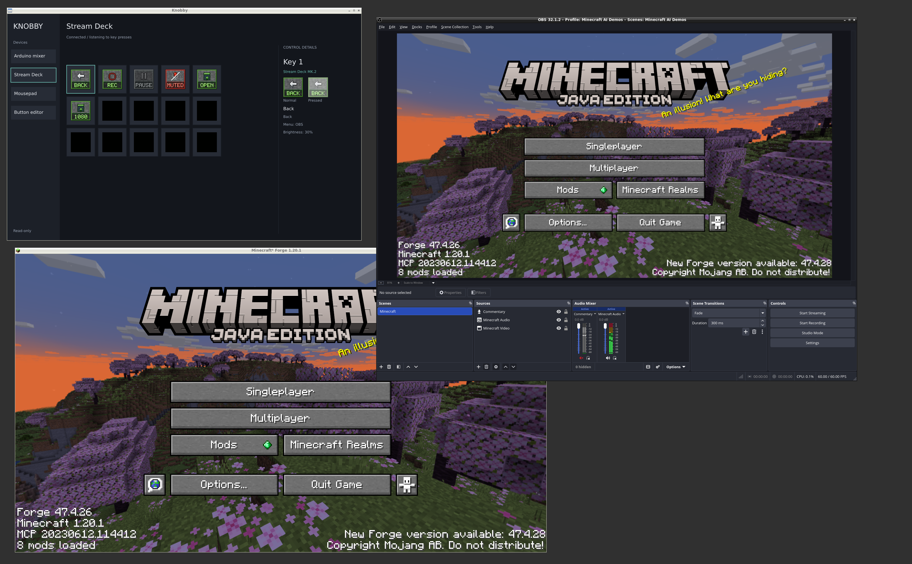

# Knobby



Knobby puts Linux audio on physical faders. An Arduino MIDI mixer controls
master, browser, music, and game volume without opening a volume panel or
leaving the app you're using. Its buttons launch apps and toggle microphone
or Discord mute.

It runs in the background, reconnects when the controller is unplugged, and
keeps app volumes at their fader levels when new audio streams appear.
With OpenRazer installed, it also gives the
[Goliathus mousepad](docs/goliathus-chroma.md) a subtle grey breathing effect.

## Scope

This is monofuel's personal setup for `high-steel`, a NixOS desktop using
PipeWire's PulseAudio compatibility layer. Bindings and desktop paths are
specific to this desktop intentionally. Buttons and menus are editable;
fader/audio targeting and lighting presets remain compiled.

The [controller](docs/hardware.md) has four faders and twelve buttons.
See the [desktop setup](docs/high-steel.md) for bindings and Discord
authorization. Adapting Knobby to another desktop means editing the bindings
through the [button editor](docs/buttons.md), or editing
[bindings.nim](src/knobby/bindings.nim) for faders and desktop integration.

## Try it

From the checkout, enter the Nix development shell and run the tests:

```sh
nix develop
nimble test
```

The shell supplies Nim and the command-line tools Knobby needs. Without Nix,
use Nim 2.0 or newer, Nimble, `alsa-utils`, `pactl`, `wmctrl`, `curl`, and
`pgrep` (from `procps`). Mousepad lighting also uses `busctl` (from `systemd`)
and the OpenRazer driver and user daemon; MIDI and audio work without OpenRazer.
The daemon uses only Nim's standard library. Tests need neither the controller
nor a running audio server.

To watch the controller's events without changing volumes or launching apps:

```sh
nim r examples/midi_monitor.nim
```

Stop the monitor with Ctrl+C. Once the desktop bindings match your setup, run
the daemon:

```sh
nim r src/knobby.nim
```

To inspect the available MIDI ports or active audio streams:

```sh
nim r examples/midi_monitor.nim -- --list
nim r examples/audio_outputs.nim
```

## Device viewer

The optional GUI edits button actions, menus, and Stream Deck artwork while
showing live device activity. Fader positions appear alongside
the actual audio output and application-stream levels. It also shows microphone
mute state and the mousepad's intended lighting preset. [Button configuration](docs/buttons.md)
covers the editor, animated images, linked Back navigation, and the shared JSON
workflow for text editors and AI tools.

The [OBS submenu](docs/obs.md) provides Minecraft recording, pause, commentary
mute, and a button to resize Minecraft to 1080p, with live state artwork.
The [Discord submenu](docs/discord.md) separates system mic mute, Discord mute,
and deafen. The MIDI mixer's top-right button brings up a temporary legend
without taking focus away from your application.

The viewer uses Windy and Silky and can stay in the system tray. See
[GUI setup](docs/gui.md) for installing its separate dependencies and launching it.
The background daemon continues independently when the viewer exits.

Install the verified daemon and tray viewer with:

```sh
nix develop --command nim r tools/install.nim
```

The viewer starts hidden at graphical login. Run `~/.local/bin/knobby-gui`
to show its window; repeated launches reuse the same process.

## Stream Deck demo

The Stream Deck MK.2 demo displays numbered keys and highlights each one
while held. Presses and releases appear in the terminal:

```sh
nim r examples/stream_deck.nim
```

It reconnects after unplugging. Ctrl+C restores the Elgato logo and exits.
See the [Stream Deck notes](docs/stream-deck.md) for hardware details. This
demo has no desktop actions; the daemon uses configured menus and actions. Stop the
daemon before running the standalone display demo so only one writer owns it.

## Background service

On high-steel, the installer deploys the checked-in
[daemon](docs/knobby.service) and [GUI](docs/knobby-gui.service) user services.
Control their lifecycle with:

```sh
systemctl --user status knobby knobby-gui
systemctl --user restart knobby
```

Services execute prebuilt binaries with their runtime dependencies. After code
changes, rerun the installer to build and test before replacing the installed
version. View logs with `journalctl --user -u knobby -u knobby-gui -f`.
